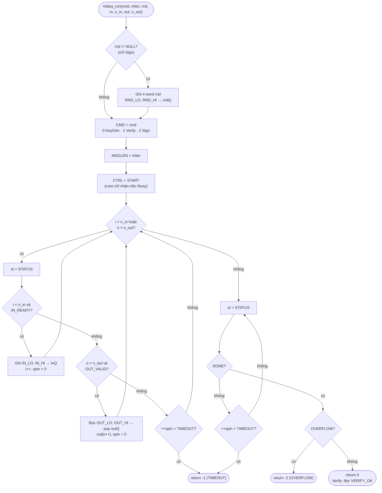

### how to use


#### Install

```
git clone <rot-riscv> && cd rot-riscv
git submodule update --init chipyard
cd chipyard && ./build-setup.sh riscv-tools --use-lean-conda --skip-ctags --skip-firesim --skip-marshal
```


### ML-DSA firmware flow

Luồng của `mldsa_run()` trong [sw/mldsa-test/mldsa.c](sw/mldsa-test/mldsa.c), điều khiển core ML-DSA qua MMIO tại `0x10007000` (wrapper: [MLDSA.scala](rot-riscv-ip/src/main/scala/cipher/MLDSA.scala)).



- `n_in` / `n_out` (số word 64-bit) do caller truyền vào: KeyGen 4 / 480, Sign `320 + m` / 303, Verify `467 + m` / 0.
- rnd được nạp vào `rndQ` (depth 4) **trước** START, nên 4 word vừa đủ.
- `START` chỉ có tác dụng khi core không busy (`i_start := start && !o_busy`); firmware không kiểm tra BUSY trước khi start.
- Input và output được xử lý xen kẽ trong cùng một vòng poll, vì `inQ`/`outQ` chỉ sâu 4 word.
- `VERIFY_OK` và `CYCLES` đọc sau khi hàm trả về; `CTRL = RESET` (soft reset) xoá trạng thái.
